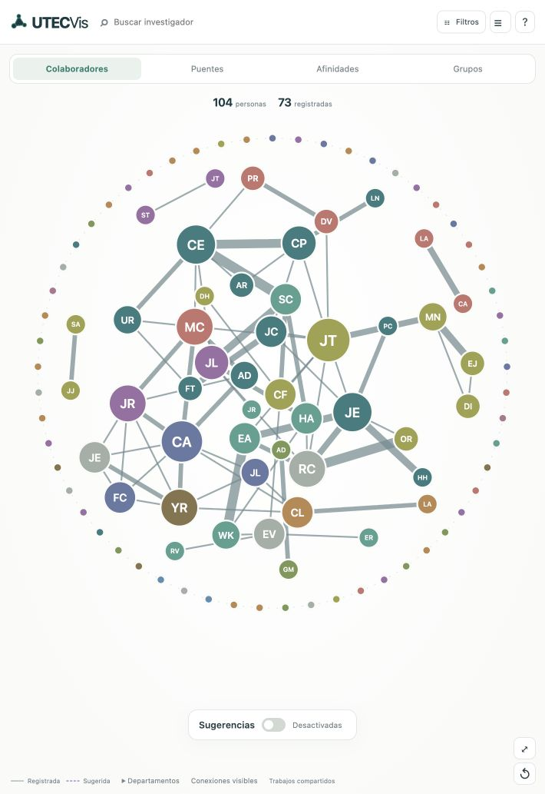
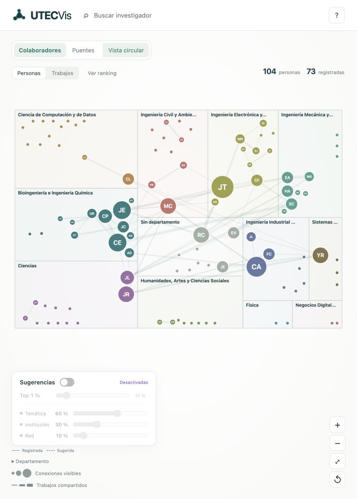

# Presentaciones de UTECVis

## 1. Intención del encargo: leer antes de preparar el PPT

Este documento es el **brief para el agente o la persona que construya la
presentación**. Debe poder continuar sin leer nuestra conversación. La entrega
actual es esta guía y las evidencias indicadas; **todavía no es un PPT terminado**.

Queremos que el profesor comprenda **qué problema resolvimos, de dónde salió cada
dato, cómo construimos y medimos las relaciones, qué decisiones visuales tomamos
y qué podemos descubrir con la aplicación**. Debe verse el trabajo y el cuidado
puestos en el proyecto mediante capturas auténticas, ejemplos verificables,
comparaciones y decisiones justificadas. No basta con mostrar una aplicación
bonita ni enumerar herramientas.

El PPT debe cubrir todo lo importante, incluyendo las fórmulas, pero **no explicar
cómo programamos Python**. No mostrar instalaciones, imports, bucles, clases,
endpoints o páginas de código como relato principal. Sí explicar la transformación
conceptual, los criterios de identidad, la evidencia de una arista, los cálculos
y sus límites. Distinguir lo que proviene de CRIS de lo que calculamos nosotros.

**Regla para cada explicación:** qué dato entra → qué transformación hacemos →
qué significa el resultado → para qué tarea sirve → dónde se ve → qué no permite
concluir. Cada fórmula debe tener variables definidas, constantes con valor y
motivo, unidades o escala, y un ejemplo numérico resuelto. Una fórmula sola no es
una explicación.

La cobertura completa se reparte entre diapositivas principales, notas del
expositor y anexos del mismo PPT. Las evidencias y las fórmulas importantes deben
verse; no esconder todo el contenido sustantivo en las notas ni copiar este
Markdown entero como texto de las láminas.

## 2. Fuentes de verdad y orden de lectura

1. Leer este archivo completo.
2. Consultar [README.md](README.md): fórmulas y ejemplos vigentes.
3. Consultar [GUIA_PROYECTO.md](GUIA_PROYECTO.md): campos, interacción y parámetros.
4. Consultar [REFERENCIAS.md](REFERENCIAS.md): antecedentes y alcance de cada cita.
5. Inspeccionar los cinco JSON de `data/` y abrir la aplicación local.
6. Revisar el código **para confirmar cálculos**, no para trasladar código al PPT.
7. Revisar las capturas incluidas; distinguir las históricas de la interfaz final.
8. Consultar Git si se necesita reconstruir una versión histórica.

Repositorio: <https://github.com/stewartmb/utecvis>. Aplicación: `localhost:5050`.
Las rutas de este documento son relativas a la raíz del repositorio.
Estado funcional tomado como referencia: commit `5488f3c`, posterior al cálculo de
intermediación simulada y a la corrección del desplegable de departamentos.
Si la app cambia después, actualizar capturas y cifras que hayan cambiado.

La consigna original es **DS5343, UtecVis: Network Visualization**, profesor
Germain Garcia-Zanabria, ciclo 2026-2. El PDF entregado por el usuario se llama
`Tarea_n.pdf`; su copia original estaba en Downloads y **no forma parte del
repositorio**. La captura de la rúbrica sí está incluida como evidencia E08.
La consigna propone ejemplos de tareas y exige al menos cuatro; no atribuirle
nuestras reglas de aristas, pesos, embeddings o máximo Top 5 %.

## 3. Criterios para la presentación

- Español claro; formato 16:9. No inventar integrantes, duración asignada o fecha
  de exposición: completar esos datos cuando se conozcan.
- La propuesta de 32 láminas de este documento es **modular**, no un número
  exigido por el profesor. Ajustar la extensión al tiempo real sin perder las
  cuatro tareas, los hallazgos, la evidencia de origen y los cálculos esenciales.
- Priorizar capturas grandes y legibles, con uno o dos focos señalados. Una
  captura completa diminuta junto a mucho texto no cuenta como buena evidencia.
- Combinar vista general para contexto y recorte ampliado para lectura. Conservar
  nombre del perfil o registro, sección y fuente; no deformar imágenes verticales.
- Poner debajo una leyenda que diga **qué estamos viendo y qué demuestra**.
  Ejemplo: “CRIS, Jimmy Tarrillo: intereses declarados por el investigador; no son
  comunidades descubiertas por nuestro algoritmo”.
- En cifras y fórmulas distinguir observado, calculado y simulado. Escribir
  “prioridad exploratoria”, no “probabilidad de éxito”.
- Usar notas con el relato, sustituciones numéricas, enlaces y dudas previsibles.
  En la lámina, dejar solo los elementos que el público necesita para seguirlo.
- Respetar las convenciones de la app: color categórico por departamento, línea
  continua registrada, violeta discontinua sugerida. No añadir códigos de color
  contradictorios en las explicaciones.
- Mostrar referencias cerca de la decisión que respaldan y la bibliografía al
  final. Una captura ajena debe identificarse como ajena; no hacerla pasar por
  una versión de UTECVis.
- Mostrar mejoras y limitaciones reales. “Eliminamos todos los cruces” o “el
  modelo predice con precisión” no son resultados obtenidos.

## 4. Las cuatro tareas que organizan el relato

Seguir la separación de **por qué / qué / cómo** de Brehmer y Munzner: propósito
analítico, datos necesarios y representación/interacción. Un botón no se convierte
por sí solo en una tarea nueva. “Pasar el cursor” es una operación; la finalidad
puede ser consultar o comparar una relación.

| Tarea de dominio | Acción y datos | Cómo la vista ayuda | Resultado que se debe demostrar |
|---|---|---|---|
| **T1. Identificar a los investigadores con más colaboradores registrados** | Localizar extremos y comparar grado; consultar trabajos compartidos como contexto | Tamaño en Colaboradores, foco y detalle | Jimmy tiene 9 colaboradores; distinguirlo de quien concentra más trabajos por pareja |
| **T2. Identificar investigadores que conectan partes de la red y examinar si enlazan departamentos** | Localizar intermediación alta y consultar conexiones/afiliaciones | Puentes, tamaño por B y resaltado de vecinos | Mostrar una persona con B alta y conexiones a otros departamentos; B por sí sola no demuestra esa condición institucional |
| **T3. Caracterizar la integración y el aislamiento de los departamentos en la cohorte** | Reconocer pertenencias y explorar conexiones internas y externas al bloque | Treemap por departamento, color y foco | Comparar un bloque integrado con Humanidades, Física o Negocios Digitales bajo las reglas de la red |
| **T4. Explorar parejas sin colaboración registrada con afinidad y cómo cambiaría la estructura si se conectaran** | Buscar candidatas, comparar señales y escenarios | Sugerencias, Top %, pesos, coincidencias y B simulada | Mostrar una pareja concreta, explicar su puntuación y separar hipótesis de evidencia registrada |

No convertir las tareas en cuatro preguntas sobre menús. Las subpreguntas sobre
un departamento, un aislado o un puente particular pertenecen a estas tareas.
La vista facilita exploración y localización de extremos; no fingir que el tamaño
circular permite ordenar exactamente 104 valores o que un treemap cuantifica por
sí solo la intensidad de colaboración institucional.

## 5. Datos que hay que presentar y respaldar

### 5.1 Origen y alcance

Fuente principal: **CRIS UTEC**, directorio de personas:
<https://cris.utec.edu.pe/es/persons/>.
Se recorrieron el directorio, perfiles, listados de publicaciones/proyectos y
huellas; se enriquecieron fichas de trabajos cuando estaban disponibles.
La adquisición fue scraping de HTML público mediante una sesión admitida de
Safari cuando el acceso directo quedaba bloqueado. No se usó el pequeño JSON del
profesor como sustituto de nuestra extracción.

Explicar el acceso solo como contexto de adquisición. No dedicar diapositivas a
cookies, Apple Events o funcionamiento interno de Python. La extracción completa
actual necesita el entorno descrito en el README; **no afirmar que funciona en
cualquier PC simplemente abriendo un navegador**. La app entregada sí funciona
con los datos locales, sin scraping ni modelo descargándose durante la exposición.

**Alcance:** 104 perfiles de la cohorte obtenida, no una garantía de representar
a toda persona que haya investigado en UTEC ni toda su colaboración mundial.
Las cifras describen la instantánea incluida, no una consulta en tiempo real.
Los timestamps individuales de origen están en los registros.

| Elemento | Cantidad actual | Precisión necesaria en el relato |
|---|---:|---|
| Investigadores/nodos | 104 | Una persona de la cohorte por nodo |
| Conexiones registradas | 73 | Parejas únicas, no 73 publicaciones |
| Publicaciones del catálogo | 2.474 | Registros deduplicados vinculados a la cohorte; no todos crean aristas internas |
| Proyectos | 129 | Registros disponibles con participantes |
| Fotos locales | 102 | Dos perfiles no publican foto |
| Departamento publicado | 95 | Nueve sin departamento reconocido |
| Intereses declarados | 90 | Ausencia de campo no significa ausencia de intereses |
| Huella temática disponible | 80 | Diferente de intereses declarados |
| Afiliaciones relevantes para I | 102 | No confundir esta cobertura con los 95 departamentos |
| Respaldo temático por biografía | 5 | Solo cuando faltan intereses y huellas |
| Conectados / aislados | 47 / 57 | Aislados dentro de esta cohorte y definición |
| Componentes observados | 62 | Incluyen los 57 aislados |
| Parejas posibles / candidatas | 5.356 / 5.283 | Candidatas excluye las 73 registradas |

### 5.2 Cómo encontramos los campos: fuente → significado → uso

Mostrar la sección visible de CRIS al lado de un ejemplo reducido del dato
transformado. No hace falta enseñar selectores HTML en la lámina principal.

| Campo de nuestro modelo | Dónde se encontró | Ejemplo verificable | Uso |
|---|---|---|---|
| `name`, `source_url`, foto | Cabecera del perfil y enlace del directorio | Jimmy Tarrillo Olano | Identidad, búsqueda, detalles y reconocimiento |
| `id` | Identificador interno estable derivado de la URL normalizada | Jimmy: `1820964964584464` | Unir tablas sin depender del orden o solo del nombre; no es un ProfessorID oficial entregado por CRIS |
| `department`, `departments` | Afiliaciones de la cabecera | Ingeniería Electrónica y Mecatrónica | Color, bloque y exploración; la vista usa el primer departamento reconocido |
| `research_areas` | Sección **Temas de Interés de Investigación** | Jimmy: tolerancia a fallos en FPGAs, sistemas embebidos, etc. | Señal temática declarada |
| `fingerprint` | Vista **Huella digital / Fingerprint** | Field Programmable Gate Array; Soft Error; Embedded System | Señal temática conceptual |
| `concept_id`, `label`, `weight`, `subject` | Conceptos y metadatos de esa vista | FPGA: peso 1; Soft Error: 0,469750888… | Identificar y ponderar conceptos; el peso no es número de publicaciones ni probabilidad |
| `affiliations` | Lista común de organizaciones enlazadas | SERMIC, BIO, departamento | Señal institucional por organización compartida |
| `affiliations[].type` | Clasificación del ETL a partir del nombre de organización | `research_group`, `research_center`, `institute`, `department` | Separar categorías; no son cuatro campos independientes del perfil CRIS |
| `source_classes` | Marcas del HTML conservadas | `researchgroup`, `center` | Respaldo de origen; ASRI puede tener clase `center` y nombre de instituto |
| `organisation_id` | ID interno derivado de la organización | Conservar además la URL CRIS original | Comparación por identidad, no por parecido entre textos |
| Publicaciones, autores y DOI | Listado y ficha de publicación | Carmen Flores y Samuel Charca en el ejemplo de la sección 5.4 | Evidencia de coautoría y deduplicación |
| Proyectos y participantes | Listado y ficha del proyecto | Proyecto de paneles de fibrocemento | Evidencia de participación compartida |
| Coautores visibles fuera de la cohorte | Nombres y enlaces de participantes | Publicación de Guillain–Barré de la sección 5.4 | Contexto; no crear nodos nuevos |
| Biografía | Perfil profesional | Solo respaldo en cinco perfiles | Menor cobertura temática señalada en detalles |
| Citas, h-index, educación y enlaces externos | Secciones y enlaces publicados cuando existen | Pueden contener `null` | Enriquecimiento conservado; no alimentan tamaño, T, I o R |
| `network_metrics`, T, I, R, S | **Calculados por nosotros** | B de Jimmy; I recalibrada | Análisis, codificación y sugerencias; no vienen publicados como tales en CRIS |

El campo antiguo `research_groups` mezcla nombres de grupos y centros. **I usa
`affiliations` estructuradas**. No decir que compartir grupo y compartir centro
son dos casillas independientes que CRIS haya entregado ya listas para puntuar.

Para el agente que necesite comprobar la extracción: `cris.py` identifica los
intereses por su encabezado; `research.py` recoge el concepto visible y atributos
`data-concept-uuid` y `data-rank-value`; `profile_extras` lee organizaciones de la
cabecera. Estos detalles pertenecen a notas de preparación o anexo, no al relato
oral sobre programación.

### 5.3 Conexiones y límite de cohorte

- Nodo = persona de nuestra cohorte; red sin dirección, sin autoenlaces.
- Arista registrada = coautoría individual reconocida por URL CRIS/ORCID **o**
  participación publicada en un mismo proyecto.
- Una pareja aparece una vez; guarda separadas las evidencias de ambos tipos.
- 35 parejas tienen coautoría; 51 comparten proyecto; 13 tienen ambas evidencias:
  `35 + 51 − 13 = 73`. No sumar 35 y 51 como si fueran pares disjuntos.
- Una publicación vinculada a dos perfiles por autoría colectiva o asociación de
  perfil **no basta** para afirmar coautoría individual. Se conserva en el
  catálogo, pero no crea arista ni peso.
- Compartir departamento o grupo no crea una arista registrada: alimenta I.
- Un colaborador fuera de los 104 no entra como nodo ni aumenta grado/B/R.
  Conservar su nombre como contexto en registros, sin fingir que fue eliminado
  de la publicación original.
- `faculty_id: null` significa **fuera de la cohorte o no identificado dentro de
  ella**. No demuestra automáticamente que pertenezca a otra universidad.
- La red de coautores de CRIS puede incluir otras personas y otras reglas. No
  esperar que el número del portal coincida necesariamente con nuestro grado.

### 5.4 Casos reales para capturas y explicación

**Perfil principal: Jimmy Tarrillo Olano**

- Perfil e intereses: <https://cris.utec.edu.pe/es/persons/jimmy-tarrillo-olano/>.
- Huellas: <https://cris.utec.edu.pe/es/persons/jimmy-tarrillo-olano/fingerprints/>.
- Grupo publicado: SERMIC. Departamento: Ingeniería Electrónica y Mecatrónica.
- Grado 9; grado ponderado 11; B observada 0,0679675106…; articulación.
- Conceptos guardados: Field Programmable Gate Array (1), Soft Error
  (0,469750888…), Embedded System (0,427046262…).
- Mostrar intereses y huellas como fuentes complementarias, no como duplicados
  exactos ni como temas que nosotros inventamos.

**Coautoría y peso: Carmen Elena Flores Barreda – Samuel Charca Mamani**

- IDs: `1745516346752422` y `1973806351557672`.
- Peso 8 = 6 publicaciones + 2 proyectos distintos.
- Publicación de ejemplo: [Assessment of the mechanical properties of Peruvian
  Stipa obtusa fibers for their use as reinforcement in composite materials](https://cris.utec.edu.pe/es/publications/assessment-of-the-mechanical-properties-of-peruvian-stipa-obtusa-/),
  DOI `10.1016/j.compositesa.2020.105950`. Verificar el título literal en la ficha
  antes de copiarlo; la pareja y el DOI están en las evidencias del JSON.
- Proyecto de ejemplo: [Fabricación de paneles de fibrocemento](https://cris.utec.edu.pe/es/projects/103-2018-fondecyt-fabricaci%C3%B3n-de-paneles-de-fibrocemento-utilizan/).
- La captura debe mostrar ambos participantes, no solo el título del trabajo.

**Autores fuera de cohorte**

- [Guillain–Barre syndrome outbreak in Peru: Association with polymorphisms in
  IL-17, ICAM1, and CD1](https://cris.utec.edu.pe/es/publications/guillainbarre-syndrome-outbreak-in-peru-association-with-polymorp/),
  DOI `10.1002/mgg3.960`.
- Autores reconocidos de la cohorte: Julio Ernesto Valdivia Silva y Heinner
  Hilario Guio Chunga. También figuran autores sin identificación en la cohorte,
  por ejemplo Luis Jaramillo-Valverde y Kelly S. Levano.
- Anotar en la captura cuáles están representados y cuáles permanecen solo como
  contexto. No atribuir afiliaciones externas que no se hayan comprobado.

**Autoría colectiva excluida de aristas**

- [Measurement of the W boson mass](https://cris.utec.edu.pe/es/publications/measurement-of-the-w-boson-mass/),
  DOI `10.1007/jhep01(2022)036`, autor colectivo “The LHCb collaboration”.
- Explicar por qué un trabajo asociado a perfiles no equivale automáticamente a
  una relación individual comprobada. La antigua asociación de 432 registros se
  retiró del grafo; no presentarla como 432 colaboraciones personales verificadas.

**Centro compartido**

- [Deyby Huamanchahua Canchanya](https://cris.utec.edu.pe/es/persons/deyby-huamanchahua-canchanya/)
  y [Julio Ernesto Valdivia Silva](https://cris.utec.edu.pe/es/persons/julio-ernesto-valdivia-silva/):
  comparten Centro de Investigación en Bioingeniería – BIO. I = 34,48/100.
- Deyby no tiene intereses declarados en los datos, pero sí huella; sirve para
  explicar fuentes disponibles sin tratar una lista vacía como desinterés.

**Grupo compartido**

- [Luis Ernesto Flores Luyo](https://cris.utec.edu.pe/es/persons/luis-ernesto-flores-luyo/)
  y [Julio Gutierrez Alva](https://cris.utec.edu.pe/es/persons/julio-gutierrez-alva/):
  comparten DADS; I = 100/100. Si Institución tiene peso 100 %, S puede dar 100
  aunque T sea menor y R sea cero. Eso expresa el criterio elegido, no certeza.

**Ejemplo completo de S**

- Jose Javier Cerda Hernandez (`204309335274068`) y Jose De La Puente Maldonado
  (`349372305644751`), mismo departamento.
- T = 0,470273; I = 0,2059785624…; R = 0; S inicial = 34,40/100.
- Ambos tienen grado observado cero: R = 0 no impide temática o institución.

**Aislado con afinidad**

- [Luz Antuanet Adanaque Infante](https://cris.utec.edu.pe/es/persons/luz-antuanet-adanaque-infante/):
  grado registrado 0, con intereses y huellas publicados.
- Su mejor candidata con los pesos iniciales es la pareja con **Luciano Arnaldo
  Romero Calla**: T = 0,840358; I = 0,2059785624…; R = 0; S = 56,60/100.
- Ocupa el lugar **100 de 5.283 candidatas** con la instantánea y el desempate
  actuales. Top 1 % no la incluye; **Top 2 % (106 parejas)** sí. No preparar una
  demo que espere verla aparecer en el Top 1 %.

## 6. Transformación: lo que debe entender el público

Mostrar un flujo conceptual con ejemplos, sin código:

**Páginas públicas → identidad y campos → trabajos deduplicados → parejas con
 evidencia → métricas y afinidades → visualización**.

1. Normalizar enlaces y conservar una identidad estable por persona; no unir
   personas solo por nombres parecidos. Conservar URL de origen.
2. Normalizar espacios/Unicode y distinguir ausencias de ceros. El departamento
   principal se toma del primero reconocido; las otras pertenencias se conservan.
3. Clasificar las afiliaciones sin sumar varias veces coincidencias relacionadas.
4. Unificar publicaciones por DOI; si falta, por URL. Proyectos por URL.
5. Reconocer participantes internos mediante enlaces explícitos y ORCID cuando
   corresponda; excluir roles como editor, traductor o compilador del conjunto
   que sirve como evidencia de autoría.
6. Crear las combinaciones por parejas entre participantes internos elegibles.
   Un trabajo con A, B y C produce A–B, A–C y B–C: tres parejas, no tres trabajos.
7. Conservar evidencia de cada arista y separar autoría colectiva no confirmada.
8. Calcular métricas solo sobre las 73 aristas registradas. Preparar T/I/R para
   las parejas; S se ajusta con los controles. B simulada se calcula aparte.
9. Mantener cinco JSON finales, sin carpetas por ejecución. Publicaciones y
   proyectos contienen contexto que no necesariamente aparece como arista.

| Archivo | Qué debe mostrar el PPT de él |
|---|---|
| `data/network.json` | Nodo, arista, peso, evidencia y métricas observadas |
| `data/publications.json` | Un trabajo con autores internos y fuera de cohorte; DOI y origen |
| `data/projects.json` | Un proyecto con participantes y fuente |
| `data/organisations.json` | Organización, tipo y miembros |
| `data/analysis.json` | Componentes/comunidades y señales T/I/R con metodología |

Mostrar ejemplos reducidos y legibles, no capturas de cientos de líneas JSON.
La evidencia principal es la fuente y su traducción a significado analítico.

## 7. Registro de fórmulas y leyendas obligatorias

Cada referencia Fxx debe resolverse en la diapositiva indicada o en su anexo
vinculado. Las fórmulas siguientes describen la versión actual. En el cálculo se
conserva precisión; el PPT redondea solo para facilitar lectura.

### F01. Arista y peso

`w_AB = publicaciones individuales compartidas + proyectos compartidos`.
A y B son profesores; w cuenta **trabajos distintos por pareja**, no personas.
Ejemplo Carmen–Samuel: `6 + 2 = 8`. Se crea arista si w > 0 bajo las reglas de
evidencia. Por qué: diferenciar existencia y repetición del vínculo.

### F02. Grado y grado ponderado

`k(v) = |vecinos registrados de v|`; `W(v) = Σ_u w_vu`.
v es un profesor; u recorre sus vecinos; las barras son cantidad de elementos.
Jimmy: k = 9 y W = 11. Carmen: k = 7 y W = 20. Conclusión: más colaboradores y
más trabajos compartidos son preguntas distintas. W no es producción total única.

`centralidad_grado(v) = k(v)/(N−1)`; N = 104. Jimmy: `9/103 = 0,0873786`.
Esta normalización está guardada, pero no es otra vista independiente.

### F03. Intermediación observada

`B(v) = [Σ_(s<t; s,t≠v) σ_st(v)/σ_st] / [(N−1)(N−2)/2]`.

- s y t: otras dos personas; v: persona cuyo papel de paso medimos.
- σ_st: número de caminos con **menos pasos** entre s y t.
- σ_st(v): cuántos de esos caminos atraviesan v; los extremos no cuentan.
- Cada arista vale un paso; no usamos frecuencia de trabajos como distancia.
- Si existen dos caminos mínimos y uno pasa por v, la pareja aporta 1/2.
- Parejas desconectadas aportan cero. N incluye los 104 nodos, también aislados.
- Divisor: `103 × 102 / 2 = 5.253`. Rango teórico 0–1.
- Máximo observado: Jimmy, B = 0,0679675106… No significa 6,8 % de probabilidad.

Usar primero un pequeño ejemplo de camino dibujado con personas A–B–C y un
camino alternativo; rotularlo **“Ejemplo didáctico”**. Después mostrar el profesor
real y su valor. No presentar números del ejemplo inventado como datos de UTEC.

### F04. Intermediación simulada

`G_sim = (V, E_registradas ∪ E_sugeridas_mostradas)`; aplicar F03 a G_sim.
V sigue teniendo 104 personas. Una pareja seleccionada que conserve su línea
fuera del Top también participa en el escenario. Filtros alteran las sugerencias
mostradas, pero no eliminan aristas registradas ocultas de este cálculo.

R y S siguen usando la red observada; **B_sim no vuelve a alimentar sugerencias**.
Sin capa: tamaño por B observada. Con capa: tamaño por B_sim. Una nueva ruta puede
reducir B al evitar que otros deban pasar por el mismo nodo.

Ejemplo reproducible, sin filtros, pesos 60/30/10, sin pareja extra seleccionada:

| Escenario | Aristas totales | B de Jimmy | Máximo B del escenario | Radio de Jimmy |
|---|---:|---:|---:|---:|
| Registradas | 73 | 0,06796751 | 0,06796751 | 51 |
| + Top 1 % | 126 | 0,08577835 | 0,09366122 | 49,11 |
| + Top 5 % | 338 | 0,04148199 | 0,09458883 | 36,14 |

Este caso explica por qué B puede aumentar y el radio relativo bajar: también
cambia el máximo usado por F07. Consultar los valores para comparar magnitudes.

### F05. Componentes, aislados, articulaciones y densidad

- Componente: conjunto unido por algún camino; 62 en la red observada.
- Aislado: k = 0; hay 57. No afirmar que no investiga o que no tiene coautores.
- Nodo de articulación: al retirarlo aumentan componentes; hay 9.
- Arista puente: al retirarla aumentan componentes; hay 13. No confundir con B.
- `densidad = E / [N(N−1)/2] = 73/5356 = 0,01363 ≈ 1,36 %`.
  E es número de aristas, N número de nodos; no suma pesos.

### F06. Área del treemap

`área_bloque_d / área_total ≈ n_d / N_visible`.
d es un departamento; n_d sus miembros visibles; N_visible, todos los nodos
visibles. La proporción se aplica al reparto del treemap; bordes, márgenes y
cabeceras consumen superficie de dibujo. Ejemplo sin filtros: Computación
14/104 ≈ 13,46 %. **Área representa personas, no trabajos, grado ni productividad.**
Los nueve sin departamento forman un bloque de información desconocida.

### F07. Tamaño de nodo

**Colaboradores:** `radio = 7 + 44 × k_visible / 9`.
k_visible cuenta vecinos por aristas registradas y sugeridas que se dibujan.
9 es el mayor grado **registrado** actual y no cambia al filtrar ni al sugerir.
7 es el radio mínimo y 44 la amplitud: constantes visuales, no datos académicos.

Ejemplos k_visible = 0, 1, 4, 9 → radios 7; 11,89; 26,56; 51 unidades SVG.
Con sugerencias puede superar 51. **Es lineal en radio, no en área**; se eligió
para reforzar contraste. Explicar esa elección y su distorsión perceptual, no
presentarla como codificación proporcional del área.

**Puentes:** `radio = 7 + 44 × √(B_usada / B_max_usada)`.
Sin sugerencias: B y máximo observados. Con sugerencias: B_sim y máximo del
escenario. Máximo de radio 51; si todas las B son cero, todos quedan en 7.
La raíz cuadrada da al área adicional una relación más cercana a la magnitud,
pero el radio mínimo introduce una base: no afirmar proporcionalidad exacta del
área total. Los tamaños son relativos al máximo de cada escenario.

Radio y diámetro no son lo mismo: `diámetro = 2 × radio`. Son unidades del SVG;
el zoom modifica sus píxeles en pantalla. Las fotos aparecen a partir de **25 px
de diámetro en pantalla**; no es un radio ni un umbral de calidad académica.

### F08. Grosor de arista

`grosor(w) = 1,5 + 4,5 × ln(w)/ln(8)` para el rango registrado actual 1–8.
1,5 y 6 son los extremos visuales en px; 4,5 = 6−1,5; 8 es el mayor peso actual.
w = 1, 2, 8 → grosores 1,5; 3; 6 px. El conteo exacto se consulta en el detalle.
La escala logarítmica contiene la diferencia entre frecuencias sin ocultar los
vínculos pequeños. Sugeridas: grosor fijo 1,4 px; **no representa su S**.

### F09. Relevancia de conceptos y embeddings temáticos

`IDF(c) = ln((N_h + 1)/(df(c) + 1)) + 1`.
N_h = 80 perfiles con huella; df(c) = perfiles con ese identificador de concepto.
Los +1 suavizan el cálculo. `q(c) = peso_CRIS(c) × IDF(c)`.
El peso CRIS es relevancia publicada, no una frecuencia de colaboración.

Ejemplo **didáctico** con N_h = 80: df = 1 → IDF ≈ 4,70; df = 40 → IDF ≈ 1,68.
Con peso CRIS 0,5, q ≈ 2,35 frente a 0,84. Verificar los redondeos al maquetar.
Un término común discrimina menos. Excluir `Peru` y `Numerical Example` y pesos
no positivos; conservar los datos originales. Deduplicar etiquetas conservando
mayor q; seleccionar hasta 20 conceptos por perfil. 20 y las exclusiones son
decisiones nuestras, no una regla exigida por MiniLM ni por CRIS.

MiniLM genera embeddings multilingües; no es un campo que venga del portal.
Modelo: `sentence-transformers/paraphrase-multilingual-MiniLM-L12-v2`, revisión
`e8f8c211226b894fcb81acc59f3b34ba3efd5f42`. Es preentrenado; no lo entrenamos
con nuestros 104 perfiles.

`u_A = normalizar(promedio(embeddings de intereses))`.
`f_A = normalizar(Σ q(c) embedding(c) / Σ q(c))`.
`v_A = normalizar(promedio de las fuentes disponibles u_A y f_A)`.
`normalizar(x) = x/||x||`, donde ||x|| es longitud del vector.
Igual importancia por fuente evita que más etiquetas anulen los intereses por
cantidad. Solo si faltan ambas se usa biografía, marcada como respaldo.
Los fragmentos respetan el límite del modelo: longitud máxima menos dos tokens,
con solapamiento de 16. Esto se explica en anexo, sin enseñar código.

### F10. Similitud temática T

`T(A,B) = limitar_a_0_1[(v_A · v_B)/(||v_A|| ||v_B||)]`.
El punto es producto escalar; los vectores representan los textos de cada
profesor. Se lleva a cero la similitud negativa. T está en 0–1 y se muestra ×100.

Control real: Machine learning ↔ Aprendizaje automático = 0,835962; Machine
learning ↔ Mecánica de suelos y cimentaciones = 0,146285. Demuestra un ejemplo de
coherencia multilingüe, no una evaluación exhaustiva de afinidad científica.
No sumar títulos y abstracts como señales extra: pueden duplicar producción ya
representada en huellas. No incorporar citas o fotografías a esta señal.

### F11. Institución I: calibración descriptiva

Primero seleccionar una sola coincidencia: grupo → centro/instituto → departamento
→ ninguna. No es un organigrama anidado demostrado; es la prioridad elegida.

| Categoría excluyente | Parejas | Registradas | p_c | I × 100 |
|---|---:|---:|---:|---:|
| Grupo | 94 | 18 | 19,1489 % | 100 |
| Centro/instituto sin grupo | 85 | 6 | 7,0588 % | 34,48 |
| Departamento sin coincidencia superior | 378 | 17 | 4,4974 % | 20,60 |
| Ninguna coincidencia, información suficiente | 4.594 | 32 | 0,6966 % | 0 |
| Información insuficiente | 205 | 0 | No estimada | N/D |

`p_c = registradas_c / parejas_c`.
`p_0 = 32/4594`; `p_g = 18/94`.
`I(c) = limitar_a_0_1[(p_c − p_0)/(p_g − p_0)]`.

p_0 es la base sin coincidencia; p_g la referencia de grupo; p_c la categoría que
se puntúa. Ejemplo centro: `((6/85)−(32/4594))/((18/94)−(32/4594)) = 0,3447937`.
Explicar la resta de la base y el reescalado: 34,48 es un contraste relativo,
**no 34,48 % de probabilidad de colaborar**. Usar fracciones completas, no
porcentajes redondeados para recalcular.

Los antiguos valores 100–70–40 eran heurísticos y fueron sustituidos. No mostrar
70/40 como metodología vigente. Las proporciones proceden de todas las parejas,
no solo candidatas ni solo las filtradas. No sumar grupo+centro+departamento ni
puntuar compartir UTEC/facultad general. Datos insuficientes → null.
La calibración usa la misma red observada; seis positivos en centros son pocos y
las parejas no son independientes. No atribuir causalidad o validación predictiva.

### F12. Proximidad en red R: paseo con reinicio

Desde A, continuar por aristas registradas con probabilidad 0,90 y reiniciar en A
con 0,10. Al continuar, seleccionar vecino proporcionalmente al peso del vínculo.
Si A tiene vecinos con pesos 2 y 6: 2/8 = 25 % y 6/8 = 75 % **condicionados a
continuar**; son 22,5 % y 67,5 % del paso completo, más 10 % de reinicio.
Un nodo sin salidas vuelve al origen.

`P_A = 0,90 Mᵀ P_A + 0,10 e_A`.
M = matriz de transición por pesos salientes; e_A concentra el reinicio en A;
P_A(B) = masa estacionaria en B al reiniciar en A. No es una probabilidad de que
A y B colaboren. El símbolo T elevado significa transpuesta, no señal temática.

`R_bruto(A,B) = (P_A(B) + P_B(A))/2`.
`R(A,B) = min(1, R_bruto(A,B)/máximo_positivo_entre_no_conectadas)`.
El promedio hace simétrica la pareja. El máximo se calcula sobre candidatas de
la red completa. Si no es positivo, R = 0 para todas. Componentes diferentes e
inaccesibilidad desde aislados → R = 0. Parámetros numéricos: hasta 1.000
iteraciones, tolerancia 10⁻¹². 90/10 es una decisión exploratoria documentada,
distinta del peso global de Red, que empieza en 10 %.

### F13. Combinación, contribuciones y cobertura

`S = αT + βI + γR`; α = 0,60, β = 0,30, γ = 0,10; mostrar `100S`.
T/I/R son resultados por pareja; α/β/γ son importancias elegidas por el usuario.
60/30/10 es nuestro escenario inicial, no un entrenamiento ni una regla del paper.

Cerda–De La Puente: `0,60×0,470273 + 0,30×0,2059785624 + 0,10×0 = 0,34395737`.
Mostrar 34,40/100; temática aporta 28,22 puntos, institución 6,18 y red 0.
Los aportes suman el resultado, no los valores crudos de las tres barras.

`S_con_faltantes = Σ_(j disponible) a_j señal_j / Σ_(j disponible) a_j`.
`cobertura = Σ_(j disponible) a_j / Σ_(todos) a_j`.
Ejemplo didáctico con T = 0,5, I = null, R = 0: S = 0,30/0,70 = 0,428571;
cobertura 70 %. Con I = 0 conocido: S = 0,30 y cobertura 100 %.
Esta comparación muestra por qué null y cero no son equivalentes.
Sin señales disponibles con peso activo, no hay puntuación.

Al cambiar un peso a x %, los otros se reparten 100−x proporcionalmente a sus
valores anteriores; si ambos eran cero se divide por igual, ajustando redondeo.
Ejemplo: 60/30/10 → temática 80 % → 80/15/5. Son controles exploratorios.

### F14. Candidatas, Top % y límite visual

`parejas_posibles = N(N−1)/2 = 104×103/2 = 5356`.
`candidatas = 5356−73 = 5283`.
`cantidad = techo(candidatas_visibles × Top/100)`.
Techo redondea hacia arriba. Top 1 % → 53; 2 % → 106; 5 % → 265.
Rango 0–5 %, paso 0,1, inicio 1. Solo puntuaciones positivas; ordenar S de mayor
a menor y desempatar por IDs estables. Los filtros cambian el denominador.

`E_total = 73+265 = 338 < 4N = 416` en la vista completa al 5 %.
La orientación `E < 4N` de Munzner es una referencia de escala para nodo–enlace,
no garantía de legibilidad. El 5 % controla densidad: la demo CollaborationViz
tiene un máximo 5, pero su artículo no justifica ese número exacto y su código
no usa exactamente nuestro denominador. No atribuirle precisión científica a
este límite ni traducir Top % como probabilidad.

### F15. Comunidades calculadas: respaldo, no modo actual

`Q = (1/(2m)) Σ_ij [w_ij − s_i s_j/(2m)] δ(c_i,c_j)`.
m = suma de pesos de aristas; s_i = suma de pesos del nodo i; c_i = comunidad de i;
δ = 1 si ambos están en la misma comunidad y 0 en otro caso. La modularidad
compara concentración interna con una referencia según grados ponderados.
Se calcula con agrupación voraz ponderada de NetworkX: 10 comunidades con más
de una persona y 57 unitarias. Son resultados analíticos guardados, **no los
bloques del treemap ni una opción actual del menú**. Llevar al anexo; no inventar
una tarea de “descubrir comunidades” que la interfaz actual no ofrece.

### F16. Física, movimiento e identidad visual: anexo breve

Los parámetros D3 modifican posiciones, no atributos académicos:
separación de enlace `r_A+r_B+80`; intensidad 0,12; repulsión −130;
colisión `radio+4,5` por extremo; ocho iteraciones; atracción al centro del bloque
0,08; fricción 0,50; enfriamiento 0,035; semilla 0,42; transiciones habituales
300 ms y respeto de movimiento reducido. No son fórmulas de probabilidad.
Las sugerencias no crean resortes en el layout; sí pueden acompañar el arrastre
según vecindad visible. D3 mantiene colisiones y límites del departamento.
La distancia dibujada no mide afinidad ni distancia institucional real.

## 8. Secuencia propuesta de diapositivas principales

Cada ficha indica **lo visible**, la evidencia y el propósito oral. Los códigos
Cxx son capturas por producir; Exx son archivos ya incluidos, detallados después.
Las fichas son contenido obligatorio, aunque se fusionen o redistribuyan láminas.

### 01 · UTECVis: colaboración académica y afinidades

- Visible: nombre, integrantes reales y una captura protagonista de la vista final.
- Evidencia: C09; no usar un screenshot histórico como interfaz vigente.
- Notas: qué permite explorar y cuál es el límite de la cohorte. Sin arquitectura.

### 02 · El problema y la cohorte

- Visible: 104 investigadores, 73 vínculos registrados; colaboraciones dispersas
  en perfiles que queremos explorar conjuntamente.
- Evidencia: directorio C01 y red C09; leyenda de persona y pareja.
- Notas: la red es una representación de evidencia publicada, no toda la actividad
  real de UTEC. Diferenciar 73 parejas de 2.474 publicaciones.

### 03 · Cuatro tareas analíticas

- Visible: cuatro propósitos de la sección 4, con datos y canal visual asociado.
- Evidencia: cuatro recortes de la app, no cuatro iconos decorativos.
- Notas: traducir preguntas de dominio a localizar, comparar y explorar relaciones.

### 04 · Fuente pública: CRIS UTEC

- Visible: directorio, perfil y rutas hacia publicaciones, proyectos y huellas.
- Evidencia: C01/C02, URL visible y fecha real de captura.
- Notas: scraping propio de HTML, sesión admitida cuando fue necesaria, instantánea
  local. No explicar cómo funciona Python ni prometer acceso universal.

### 05 · Identidad, departamento y pertenencias

- Visible: cabecera de Jimmy con departamento/SERMIC; correspondencia con el dato.
- Evidencia: C02/C05; leyendas “publicado en CRIS” y “clasificación interna”.
- Notas: IDs nuestros y URLs de origen; primer departamento para el treemap;
  grupo y centro son tipos de organización, no sinónimos.

### 06 · Intereses declarados y huellas temáticas

- Visible: dos capturas grandes del mismo perfil, C03 y C04, con tres términos
  legibles de cada fuente y ejemplo de peso de huella.
- Notas: una fuente declara líneas de interés y la otra resume conceptos de
  investigación. Preparan T; no crean coautorías ni prueban colaboración.

### 07 · Publicaciones, proyectos y autores fuera de cohorte

- Visible: C06/C07/C08; marcar dos internos y autores no representados como nodos.
- Notas: evidencia de arista, participación en proyecto y límite de cohorte. Una
  publicación puede tener muchos autores pero solo dos nodos internos.

### 08 · Transformación con trazabilidad

- Visible: flujo conceptual de la sección 6 y un caso de trabajo repetido que
  termina como un solo registro; URL/DOI de origen.
- Evidencia: extracto corto de registros reales, C06 y un diagrama rotulado.
- Notas: normalización, deduplicación, identidad y evidencia; sin código.

### 09 · Qué cuenta como una conexión

- Visible: F01, pareja Carmen–Samuel, `6 publicaciones + 2 proyectos = 8`.
- Evidencia: C10 con sus trabajos; una miniatura de la fuente C06.
- Notas: 35+51−13=73. Contrastar con autoría colectiva C18; explicar retirada de
  asociaciones no confirmadas y por qué 432 no era una arista individual válida.

### 10 · Cobertura y datos ausentes

- Visible: 95 departamentos, 90 intereses, 80 huellas y cinco biografías de respaldo;
  `null ≠ 0`. Usar cantidades, no una supuesta extracción perfecta de todo CRIS.
- Evidencia: ejemplos de perfil con y sin campo; Deyby tiene huellas sin intereses.
- Notas: información publicada desigual; 102 afiliaciones relevantes para I no
  equivale a 95 departamentos. Biografía de respaldo afecta la interpretación.

### 11 · Colaboradores y trabajos compartidos

- Visible: F02 y contraste Jimmy (9; 11) / Carmen (7; 20), con rótulos explícitos.
- Evidencia: C11/C12; consultar el dato exacto, no medir círculos a ojo.
- Notas: por qué grado responde “con cuántos” y W responde intensidad por parejas.

### 12 · Intermediación: una posición de paso

- Visible: pequeño camino didáctico, reparto entre rutas alternativas, F03 con
  leyenda, divisor 5.253 y valor real de Jimmy.
- Evidencia: C13 y sus conexiones entre departamentos C14.
- Notas: puentes estructurales frente a afinidad; no usar peso como distancia;
  separar arista puente, nodo de articulación y B.

### 13 · Primera representación: fuerzas con contorno circular

- Visible: E01, rotulada “Versión histórica: red depurada de 73 aristas”.
- Notas: los aislados estaban en el contorno y los conectados en el interior.
  Ventaja: seguir relaciones; problema: comparar pertenencias entre colores era
  más costoso. No afirmar que eran comunidades o una circunferencia estadística.

### 14 · Ajustes y prueba del treemap

- Visible: E02 y E03, mismo caso, con dos anotaciones sobre tamaños y agrupación.
- Notas: contraste insuficiente, saturación de enlaces y controles repetidos;
  explicar el cambio hacia bloques institucionales. Estos screenshots contienen
  menús/Top 10 % históricos: rotularlos como retirados, no metodología vigente.

### 15 · Vista final: treemap + red de fuerzas

- Visible: C09, departamento grande/pequeño y conexiones entre bloques señaladas.
- Fórmula: F06 y ejemplo 14/104. Leyenda “área = investigadores visibles”.
- Notas: idiom híbrido nodo–enlace con disposición por grupos; los rectángulos no
  son comunidades descubiertas ni aristas agregadas entre departamentos.

### 16 · Marcas y canales visuales

- Visible: una captura con llamadas a círculo, línea, rectángulo, color, tamaño,
  grosor, continuidad, transparencia y foto.
- Notas: mapa de la sección 9. La posición facilita explorar, no mide similitud.
  Color del borde conserva departamento cuando aparece foto.

### 17 · Tamaños y grosores con significado

- Visible: F07/F08, escalas con ejemplos numéricos y leyendas de radio/peso/B.
- Evidencia: C11/C13/C10 y tres muestras de grosor 1, 2 y 8 trabajos.
- Notas: radio lineal en Colaboradores; raíz en Puentes; mínimos visuales;
  sugerencias pueden aumentar grado, pero B puede subir o bajar.

### 18 · El mantra en una interacción real

- Visible: tres estados del mismo caso: panorama → búsqueda/zoom/filtro → detalle.
- Evidencia: C09/C15/C10 o C12, a la misma escala de lectura.
- Notas: qué pregunta resuelve cada paso; foco al pasar sobre nodo/arista,
  animación, arrastre, selección y Enter. No mostrar botones sin propósito.

### 19 · Temática: comparar significados

- Visible: intereses + huellas → embeddings → coseno; F10 y comparación bilingüe.
- Evidencia: C03/C04/C16 y los términos realmente disponibles.
- Notas: explicar embedding en lenguaje simple, F09 en anexo, hasta 20 conceptos,
  igual importancia por fuente y biografía de respaldo. No confundir similitud
  con complementariedad científica ni con colaboración demostrada.

### 20 · Institución: valores derivados de la cohorte

- Visible: tabla de F11 con cantidades y resultados; fórmula con p_c/p_0/p_g
  definidos; sustitución de centro que termina en 34,48.
- Evidencia: C05 y pareja BIO o DADS en C16.
- Notas: por qué dejamos 100–70–40, no sumar coincidencias, no usar universidad;
  es descriptivo sobre esta red, no validación futura.

### 21 · Red: proximidad por colaboradores intermedios

- Visible: paseo que sigue una arista o reinicia; 90/10 y ejemplo pesos 2 y 6;
  F12 simplificada con promedio de direcciones y normalización.
- Evidencia: C17 con un camino observado y caso desconectado con R = 0.
- Notas: función del reinicio, ponderación y simetrización. La ecuación matricial
  completa y su leyenda van también al anexo. Nunca usar sugerencias para R.

### 22 · Cómo se obtiene la puntuación final

- Visible: F13 y sustitución Cerda–De La Puente, contribuciones 28,22 + 6,18 + 0.
- Evidencia: C16; señalar los pesos actuales en la captura.
- Notas: resultados de señales frente a importancias; faltantes y cobertura.
  La puntuación es prioridad exploratoria, no probabilidad.

### 23 · Qué selecciona Top %

- Visible: F14, `5.356 − 73 = 5.283`; 1 % → 53 y 5 % → 265 sugerencias.
- Evidencia: C19 en estados 0/1/5, con contadores y pesos a la vista.
- Notas: redondeo hacia arriba, filtros, positivos y empate estable. Justificar
  límite visual y E<4N sin atribuir validación científica al 5 %.

### 24 · Puentes con sugerencias: escenario hipotético

- Visible: C20 comparando Top 0/1/5 en Puentes y tabla F04 de Jimmy.
- Notas: por qué cambian las rutas y los tamaños; B_sim puede bajar. Explicar
  cambio del máximo de escala, dato observado conservado y ausencia de feedback
  a T/I/R/S. No atribuir al profesor colaboraciones que solo fueron sugeridas.

### 25 · Hallazgo: cantidad de colaboradores e intensidad difieren

- Visible: evidencia T1, Jimmy 9 frente a Carmen 7; W 11 frente a 20.
- Evidencia: C11/C12 y selección de conexiones, sin inventar un ranking global
  que la app ya no tiene. Un gráfico auxiliar del PPT debe rotularse como tal.
- Notas: conclusiones limitadas a la cohorte y a la definición de trabajos.

### 26 · Hallazgo: puentes y departamentos

- Visible: Jimmy y Monica C. Santa-Maria con B y conexiones de diferentes colores.
- Evidencia: C13/C14; consultar vecinos y afiliaciones para respaldar el vínculo
  entre departamentos. Comparar también un máximo local de un departamento.
- Notas: no confundir B global con cantidad de contactos interdepartamentales.

### 27 · Hallazgo: integración y desconexión institucional

- Visible: C21; Humanidades, Física y Negocios Digitales frente a Bioingeniería.
- Evidencia: cantidades de la sección 10; encuadrar todos los miembros y desactivar
  sugerencias para hablar de conexiones registradas.
- Notas: ausencia de vínculo bajo nuestra extracción no es ausencia universal de
  colaboración; “Sin departamento” es información desconocida, no institución.

### 28 · Hallazgo: afinidad aunque no haya vínculo registrado

- Visible: Luz–Luciano con Top 2 %, T/I/R/S y términos reales en C22.
- Notas: Luz tiene k observado 0; no concluir que trabaja sola. La similitud y la
  cercanía institucional sugieren una pareja para explorar, no una colaboración
  que ya exista. Si se modifica la cohorte o pesos, comprobar posición de ranking.

### 29 · Sensibilidad y decisiones propias

- Visible: misma pareja con dos configuraciones de pesos, C23; tabla compacta de
  “calculado / elegido”. Añadir efecto de la recalibración institucional.
- Notas: 40/53 parejas se mantienen en Top 1 % y 220/265 en Top 5 % frente al
  antiguo 100–70–40, con pesos iniciales. Es sensibilidad, no mejora predictiva
  comprobada. Con solo I al 100 %, compartir grupo produce S=100 por construcción.

### 30 · Exactitud y entrega reproducible

- Visible: esquema simple fuente → datos → app; D3 para visualización y Flask
  para servirla; cinco archivos incluidos y evidencia de app funcionando local.
- Notas: NetworkX no es D3; métricas contrastadas; B_sim comparada contra NetworkX;
  datos, fotos y D3 locales. ZIP revisado después de descomprimir. No mostrar
  capturas de terminal en lugar de evidencia analítica ni repetir tests sin motivo.

### 31 · Alcances y límites

- Visible: límites junto a la afirmación que acotan: cohorte, información faltante,
  reglas de coautoría, similitud y escenarios no validados como futuro.
- Notas: las cuatro tareas se cubren de forma exploratoria; treemap no sustituye
  una comparación cuantitativa agregada ni tamaño permite ranking exacto.
  No vender el trabajo como predictor validado o censo completo de UTEC.

### 32 · Aportes, referencias y demostración

- Visible: qué permite ver la app, cuatro hallazgos breves y referencias
  fundamentales. Si no caben legibles, separar bibliografía en otra lámina.
- Evidencia: enlaces de fuentes y demo local lista; cierre conectado a las tareas.
- Notas: distinguir inspiración y decisiones propias. La demo debe continuar con
  un caso real, no terminar mostrando una lista de tecnologías.

### Anexos que deben estar dentro del PPT

A1. Rúbrica completa E08 y mapa de cobertura.
A2. Diccionario de campos, cobertura y ejemplo fuente → dato.
A3. Deduplicación y exclusión de autoría colectiva; externos y límite de cohorte.
A4. F02/F03/F05 completas, ejemplo de caminos empatados y diferencia entre puentes.
A5. F09/F10: IDF, embeddings, normalización y fuentes temáticas.
A6. F11 completa, datos ausentes, tabla de proporciones y calibración.
A7. F12 completa: transición, reinicio, simetrización, normalización y desconexión.
A8. F13: faltantes, cobertura, aportes y redistribución de controles.
A9. F14 y relación E<4N; diferencia del denominador con CollaborationViz.
A10. F04/F07: B simulada y efecto de reescalar al máximo del escenario.
A11. F15/F16: comunidades conservadas y parámetros físicos, sin inventar modos.
A12. Referencias completas, créditos de imágenes y rutas para reproducir ejemplos.

No interpretar “anexo” como contenido prescindible: debe quedar en el archivo y
ser accesible si el profesor pregunta. El PPT principal tiene que explicar el
sentido de los cálculos aunque las derivaciones extensas estén en anexos.

## 9. Mapa de marcas y canales para justificar el diseño

| Marca/canal | Dato o propósito | Qué se debe explicar | Límite |
|---|---|---|---|
| Círculo | Investigador | Identidad y unidad de análisis | No representa institución |
| Radio/tamaño | k_visible o B/B_sim según modo | F07 y leyenda contextual | No mide calidad ni producción total |
| Color/borde | Departamento principal | Categórico, gris si desconocido | No es comunidad ni orden de importancia |
| Foto/iniciales | Reconocimiento | Fotos desde 25 px de diámetro | No es dato del recomendador |
| Línea continua | Arista registrada | Coautoría/proyecto, evidencia consultable | No indica dirección |
| Grosor continuo | Trabajos compartidos | F01/F08 y conteo real | No se aplica igual a sugeridas |
| Línea violeta discontinua | Pareja sugerida | Diferenciar hipótesis de evidencia | Grosor fijo, no ranking de S |
| Rectángulo/contención | Departamento | F06, comparación de tamaño de cohorte | No mide producción ni colaboración |
| Posición por fuerzas | Explorar relaciones dentro de contenedores | Conexiones, separación y límites | Distancia no equivale a similitud |
| Transparencia/foco | Reducir saturación y seguir una selección | Nodo/arista oscurecidos y resto atenuado | No cambia datos ni métricas |
| Etiqueta/tooltip/detalle | Lectura bajo demanda | Mantener panorama legible y consultar valores | No mostrar 104 nombres superpuestos |
| Transición/arrastre/zoom | Mantener contexto y explorar | Movimiento significativo, no decoración | No es una evolución temporal de investigación |

La pregunta “por qué no otra visualización” se responde con las tareas:
la red facilita seguir caminos y vecinos; el treemap explicita pertenencias y
tamaños de departamentos; una matriz ayudaría a comparar adyacencias/densidad,
pero no se implementó. No decir que el idiom elegido es óptimo universalmente.

## 10. Hallazgos preparados con evidencia verificable

Los siguientes son resultados de la instantánea incluida. Usarlos como base, sin
ocultar las condiciones del cálculo. No fabricar hallazgos mirando solo tamaños.

| Hallazgo | Evidencia numérica | Prueba visual y lectura correcta |
|---|---|---|
| Jimmy destaca por colaboradores e intermediación | k=9; W=11; B=0,06796751 | Colaboradores/Puentes y detalle; no “mejor investigador” |
| Carmen concentra más trabajos por pareja | k=7; W=20 | Contraste con Jimmy; W no es 20 publicaciones únicas |
| Monica también ocupa una posición de paso relevante | k=6; W=9; B=0,05233517 | Vecinos de otros colores/departamentos y rutas registradas |
| Bioingeniería e Ingeniería Química tiene vínculos internos y hacia otros departamentos | 13 miembros; 11 aristas internas; 13 hacia otros departamentos conocidos; 1 hacia un perfil sin departamento | Separar estas dos clases de salidas; no llamar al desconocido un departamento real |
| Humanidades, Artes y Ciencias Sociales carece de salidas registradas hacia otros bloques | 8 miembros; 1 arista interna (Antuané De La Flor Basterrechea–Giancarlo Marcone Flores); 0 salidas | No decir que los ocho están mutuamente conectados o que ninguno colabora fuera de UTEC |
| Física y Negocios Digitales no tienen aristas registradas en la cohorte | 2 miembros cada uno; 0 aristas internas o salidas | Aislamiento de la red publicada bajo nuestra definición |
| Un aislado puede tener afinidad alta con otro perfil | Luz–Luciano: T=84,04; I=20,60; R=0; S=56,60 sobre 100 | Top 2 %, pesos iniciales; es candidata, no vínculo confirmado |
| Añadir sugerencias puede redistribuir el papel de puente | Tabla de Jimmy en F04 | Comparar B y radio, identificar escenario; no anunciar nuevas colaboraciones reales |

**Máximos locales no equivalen a B recalculada dentro de un departamento.** Por
ejemplo, Carmen es el máximo B entre miembros de Bioingeniería con B global
0,02170188; Claudia Antonini Bova es el máximo entre miembros de Industrial con
B global 0,02741291. Para llamarlas puentes entre departamentos, inspeccionar sus
vecinos; no basta con estar primeras dentro del grupo. No afirmar que la interfaz
contiene un ranking departamental si esa comparación se construye solo en el PPT.

## 11. Catálogo de capturas y evidencias

### 11.1 Archivos que YA están incluidos

Estos originales se copiaron al repositorio para que sobrevivan al clonado. Los
screenshots históricos no fueron regenerados ni retocados para parecer actuales.

| Código | Archivo | Estado y uso permitido |
|---|---|---|
| E01 | [01-circular-73-aristas.png](presentacion/evidencias/01-circular-73-aristas.png) | Histórico: fuerzas con aislados en contorno; 104/73. Lámina 13 |
| E02 | [02-circular-contraste-tamanos.png](presentacion/evidencias/02-circular-contraste-tamanos.png) | Histórico: contraste de tamaños; menús retirados. Lámina 14 |
| E03 | [03-prueba-treemap.png](presentacion/evidencias/03-prueba-treemap.png) | Histórico: prueba de treemap; aún ofrece vista circular/otros controles y Top 10 %. No es la versión final |
| E04 | [04-puentes-simulados.png](presentacion/evidencias/04-puentes-simulados.png) | Puentes con Top 1 % y leyenda de intermediación simulada; captura vertical de la app |
| E05 | [05-tooltip-con-foto.png](presentacion/evidencias/05-tooltip-con-foto.png) | Detalle compacto con foto; conservar como evidencia de la evolución, recapturar en contexto actual |
| E06 | [06-arista-resaltada.png](presentacion/evidencias/06-arista-resaltada.png) | Foco de arista; contiene disposición de controles de una versión anterior |
| E07 | [07-desplegable-corregido.png](presentacion/evidencias/07-desplegable-corregido.png) | Desplegable superpuesto correctamente; prueba de refinamiento, no pantalla central del relato |
| E08 | [08-rubrica.png](presentacion/evidencias/08-rubrica.png) | Rúbrica proporcionada por el usuario; fuente para la matriz de la sección 12 |

Vista histórica inicial:

Primera prueba de agrupación por departamentos:

### 11.2 Capturas que debe producir el agente del PPT

**Pendientes:** no afirmar que los archivos Cxx existen ya ni usarlos como
prueba de una visita realizada. Guardar los nuevos originales en
`presentacion/evidencias/`, con nombres descriptivos estables. La tabla indica qué
capturar y qué debe verse. Registrar URL/estado y fecha real en notas o pie.

| Código | Pantalla/origen | Debe mostrar | Leyenda que comunique el sentido |
|---|---|---|---|
| C01 | Directorio CRIS `/es/persons/` | Directorio, paginación y perfiles | “Fuente pública para definir la cohorte; instantánea de extracción” |
| C02 | Perfil Jimmy | Nombre, departamento, foto y SERMIC | “Identidad y pertenencias publicadas” |
| C03 | Perfil Jimmy, Temas de Interés de Investigación | Encabezado y lista legible | “Líneas declaradas; entrada de la señal temática” |
| C04 | Huellas de Jimmy | Conceptos, sección y relevancia visible o interacción del concepto | “Conceptos de huella; el peso es relevancia, no número de publicaciones” |
| C05 | Dos perfiles/organizaciones BIO y DADS | Afiliaciones coincidentes con nombre de ambos profesores | “Coincidencia institucional comprobable, sin sumar niveles” |
| C06 | Publicación Carmen–Samuel de 5.4 | Título, DOI y ambos autores individuales | “Evidencia de una coautoría interna” |
| C07 | Proyecto de fibrocemento de 5.4 | Título y ambos participantes | “Evidencia de participación compartida en proyecto” |
| C08 | Publicación Guillain–Barré de 5.4 | Autores internos y no identificados en la cohorte | “Se conservan autores fuera de la red de 104 nodos” |
| C09 | App, Restablecer, Colaboradores, sugerencias OFF | Toda la red, bloques, leyendas y contadores 104/73 | “Panorama de colaboraciones registradas” |
| C10 | App, seleccionar Carmen–Samuel | Peso 8 y lista de trabajos con fuentes | “Una pareja, ocho registros distintos” |
| C11 | App, Jimmy en Colaboradores | Nodo y tooltip/detalle con k=9 y W=11 | “Número de colaboradores distinto de trabajos compartidos” |
| C12 | App, Carmen | k=7 y W=20 con contexto de sus relaciones | “Mayor intensidad por parejas no exige mayor grado” |
| C13 | App, Puentes, sugerencias OFF | B observada y extremos destacados | “Intermediación calculada sobre la red registrada” |
| C14 | App, foco Jimmy y Monica | Vecinos y departamentos distintos identificables | “B alta más evidencia institucional de sus conexiones” |
| C15 | App, filtro por departamento y zoom | Mismo caso antes/después y filtro activo | “Reducir el conjunto visible para responder una pregunta” |
| C16 | App, detalle de pareja | Coincidencias primero, valores T/I/R/S y pesos | “Por qué esta pareja recibe esta prioridad exploratoria” |
| C17 | App, pareja con camino y otra sin camino | Camino mínimo y R, sin inventar rutas | “Proximidad estructural solo donde hay conectividad observada” |
| C18 | Ficha de autoría colectiva de 5.4 | The LHCb collaboration y contexto de autoría | “Asociación de producción no equivale a coautoría individual confirmada” |
| C19 | App, Top 0/1/5 en Colaboradores | Pesos iniciales y contadores, sin filtros | “Top selecciona una fracción de candidatas, no probabilidad” |
| C20 | App, Top 0/1/5 en Puentes | Leyenda observada/simulada, Jimmy y sus valores | “Añadir rutas puede redistribuir la intermediación” |
| C21 | App, departamentos desconectados e integrado | Humanidades/Física/Negocios frente a Bioingeniería, sugerencias OFF | “Patrones de integración dentro de la cohorte” |
| C22 | App, Top 2 %, Luz–Luciano | Arista sugerida y señales; pesos 60/30/10 | “Afinidad sin colaboración interna registrada” |
| C23 | App, misma pareja con dos juegos de pesos | Identidades y pesos constantes dentro de cada captura | “El criterio elegido cambia la prioridad, no la evidencia registrada” |
| C24 | App, hover de nodo/arista y selección por Enter | Resaltado y detalle legible | “Interacción orientada a seguir relaciones y consultar evidencia” |

Para cada captura, registrar en notas: perfil/par de IDs, modo, filtros, Top %,
pesos, sugerencias ON/OFF y alcance de la métrica. No comparar capturas cambiando
silenciosamente varias condiciones.

Capturas de la app final: preferir 1440×900 o 1920×1080 para una composición
horizontal. Acercar el campo importante sin ocultar su identidad. Si se necesitan
flechas o resaltados, conservar el original y distinguir la anotación añadida.
No borrar advertencias, cambiar cifras o componer un perfil inexistente.

Si CRIS vuelve a bloquear la sesión, no inventar screenshots ni reconstruir una
página para presentarla como fuente. Usar evidencia original disponible o un
extracto del JSON con URL rotulado **“dato guardado de la extracción”**, dejando
pendiente la captura web. Una captura de nuestra app no sustituye por sí sola la
prueba de dónde se publicó un campo.

### 11.3 Historia real y recuperación de versiones

La secuencia debe contar **una evolución de decisiones**, no una colección de
interfaces viejas sin explicación:

1. Red por fuerzas con contorno circular para aislados; E01.
2. Ajustar contraste de radio/grosor y manejo de colisiones; E02.
3. Probar agrupación por departamentos con treemap y fuerzas; E03.
4. Conservar treemap y retirar vista circular, pestañas repetidas y ranking global.
5. Añadir evidencias de pareja, fotos, controles compactos y foco de arista.
6. Recalibrar I con datos y añadir B simulada; E04/C20.

Commits útiles: `14c8d86` (exclusión de asociaciones), `896ba92` (contraste y
colisiones), `e5ebb92` (prueba treemap), `fde6afd` (retirada de circular),
`b6389e3` (I calibrada), `c2656b6` (B simulada), `5488f3c` (capas del desplegable).
Git no guarda automáticamente screenshots: por eso se incluyen E01–E08.

Si falta una captura histórica, revisar esa versión en un directorio temporal y
otro puerto, sin cambiar la rama de trabajo ni sobrescribir datos actuales.
Rotularla como reconstrucción de ese commit. No atribuir al prototipo funciones
que se añadieron después. Si no se logra reconstruir, usar la captura real
existente y explicar el cambio con sus límites.

## 12. Cobertura explícita de la rúbrica: 20 puntos

La rúbrica E08 es el criterio, no una calificación ya obtenida. Esta tabla
especifica **qué evidencia debe verse**, no solo qué afirmar oralmente.

| Criterio | Puntos | Dónde se cubre | Evidencia exigida |
|---|---:|---|---|
| Claridad de la visualización | 3 | 15–18 y toda captura final | Nodos/aristas/bloques identificables; leyendas de color, tamaño y líneas; unidades y datos ausentes claros |
| Insight analítico: colaboradores y puentes | 3 | 25–28 | Jimmy/Carmen, Jimmy/Monica y departamentos con datos reales; relación entre hallazgo, señal visual y métrica |
| Formulación y cobertura de ≥4 tareas | 3 | 03 y demos 25–28 | Las cuatro tareas de la sección 4, sus datos y operaciones, con un resultado observable para cada una |
| Razonamiento de diseño | 2 | 13–18, 23, 29 | Antes/después, ventajas y límites del treemap+red, color, radio, grosor, posición y animación conectados con tareas |
| Uso de métricas de red | 2 | 09, 11, 12, 19–24 y anexos | Fórmulas, variables, constantes, ejemplos y alcance; separar B observada de B_sim y S de probabilidad |
| Interacción y animación: D3 + mantra | 3 | 18 y demostración | Overview → zoom/filter → details on demand; hover de nodo/arista, click, Enter, zoom/arrastre y transición con propósito |
| Implementación técnica: Flask + D3 | 2 | 30 y demo local | App funcional con datos incluidos, sin otra biblioteca de visualización; sin errores visibles y entrega ZIP reproducible |
| Presentación en clase | 2 | Relato completo y guion final | Explicar objetivos, tareas, hallazgos y decisiones con dominio y dentro del tiempo realmente asignado |
| **Total** | **20** | | |

La consigna exige exponer en clase; entregar un PPT o ZIP sin exposición no
sustituye esa obligación. No prometer “20/20” basándose en una tabla de cobertura.
El profesor evalúa claridad y calidad del razonamiento, no cantidad de láminas.

## 13. Referencias que el PPT debe mantener

Tomar enlaces y matices de [REFERENCIAS.md](REFERENCIAS.md). En cada lámina indicar
qué idea respalda la fuente y qué parte es decisión de UTECVis.

| Referencia | Papel en la presentación | Atribución que hay que evitar |
|---|---|---|
| [CRIS UTEC](https://cris.utec.edu.pe/es/persons/) | Fuente de perfiles y producción; cada caso lleva URL concreta | Que CRIS entrega nuestras métricas, IDs internos o coeficientes listos |
| [CollaborationViz, artículo](https://journals.plos.org/plosone/article?id=10.1371/journal.pone.0111928) y [demo](https://bianjiang.github.io/rcna/) | Antecedente de red académica, RWR y enlaces sugeridos | Que usa exactamente nuestras fuentes, combinación o denominador del Top %; que valida nuestro 5 % |
| [Harvard Catalyst, vista exacta señalada](https://connects.catalyst.harvard.edu/profiles/display/Person/182216/Network/CoAuthors/Cluster) | Referencia de red de coautoría y exploración de relaciones | Sustituir por Harvard Faculty Explorer o afirmar idéntica codificación de tamaño/color |
| [Duke: contexto oficial](https://today.duke.edu/2017/03/webs-minds-and-ideas-bind-duke%E2%80%99s-campus) | Antecedente de similitud académica del plan | Presentar el enlace histórico caído como demo operativa o nuestra técnica como copia suya |
| [Group-in-a-Box](https://doi.org/10.1111/cgf.12400) y [Force in a Box](https://github.com/john-guerra/forceInABox) | Fundamento para agrupar red en regiones | Que implementamos exactamente el plugin o que sus grupos son nuestros departamentos |
| [Brehmer y Munzner: tipología de tareas](https://www.cs.ubc.ca/labs/imager/tr/2013/MultiLevelTaskTypology/) | Separar propósito, datos y operaciones | Que Munzner exige exactamente nuestras cuatro preguntas o prohíbe rankings |
| [Munzner: material de diseño de visualización](https://www.cs.ubc.ca/~tmm/talks/minicourse14/minicourse14-session2-4x4.pdf) | Codificación, redes y orientación E<4N | Que E<4N garantiza una red legible o justifica exactitud predictiva |
| [Sentence-BERT](https://arxiv.org/abs/1908.10084) y [MiniLM multilingüe](https://huggingface.co/sentence-transformers/paraphrase-multilingual-MiniLM-L12-v2) | Embeddings y comparación semántica | Que entrenamos el modelo o validamos afinidad científica con un solo ejemplo |
| [NetworkX: PageRank](https://networkx.org/documentation/stable/reference/algorithms/generated/networkx.algorithms.link_analysis.pagerank_alg.pagerank.html) | Implementación de PPR con personalización | Que documentación de API equivale a validación de nuestras sugerencias |
| [DRACoR](https://doi.org/10.1016/j.knosys.2020.105784) | Antecedente de combinación de señales | Que implementamos DRACoR o tomamos de allí 60/30/10 |
| [D3](https://d3js.org/) | Fuerzas, treemap e interacción de la aplicación | Que NetworkX forma parte de D3 |

No hacen falta screenshots de todas las referencias si no aportan al relato.
Los screenshots de referencias sirven para comparar una idea concreta y deben
llevar crédito; las evidencias del proyecto deben ser de nuestra fuente y app.

## 14. Preparación y entrega del PPT por el siguiente agente

1. Abrir la app y recorrer las cuatro tareas con los casos de este documento.
2. Confirmar los valores en los JSON y el alcance de cada medida antes de maquetar.
3. Capturar C01–C24 que correspondan; dejar explícita cualquier fuente inaccesible.
4. Construir el relato visual con las fichas de la sección 8, ajustándolo al tiempo.
5. Incluir todas las fórmulas F01–F16 en las láminas o anexos, con leyendas y ejemplos.
6. Añadir notas del expositor que expliquen cada afirmación y fuente.
7. Preparar una demo corta: panorama → Jimmy → Puentes/vecinos → departamentos
   desconectados → Luz con Top 2 % → comparación de escenario → restablecer.
8. Mantener capturas de respaldo de esos pasos por si falla una interacción o
   conexión. La demo de la app no depende de acceso a CRIS.
9. Comprobar contenido, legibilidad y cobertura de rúbrica; no repetir todos los
   tests del proyecto para cambiar texto de una lámina.
10. Entregar un PPTX editable, un PDF si se solicita, las capturas necesarias y
    esta guía actualizada con cualquier cambio real. No incluir `.venv`, cachés,
    modelos descargados o historiales completos de ejecución en el paquete.

La arquitectura y datos ya están preparados. No rehacer extracción ni cambiar
métricas para obtener una lámina más vistosa sin una razón analítica y sin dejar
constancia del cambio. No convertir sugerencias en colaboraciones verificadas.

### Preguntas que el expositor debe poder responder

- ¿De dónde sale un nodo, un identificador y una arista?
- ¿Cómo sabemos que ambos participaron en ese trabajo y por qué no contar externos?
- ¿Por qué el número de trabajos no es igual al número de colaboradores?
- ¿Qué significa cada variable de B y por qué hay 5.253 en el divisor?
- ¿Por qué compartir grupo vale 100, centro 34,48 y departamento 20,60?
- ¿Qué genera MiniLM y qué compara el coseno? ¿Qué se hace con los campos ausentes?
- ¿Qué hace el reinicio de RWR y por qué hay R=0 en perfiles temáticamente afines?
- ¿Por qué los pesos empiezan en 60/30/10 y qué cambia al moverlos?
- ¿Qué porcentaje representa Top 5 % y cuántas líneas añade realmente?
- ¿Por qué un profesor puede hacerse más pequeño al añadir sugerencias en Puentes?
- ¿Qué representa el área del treemap y qué problema resolvió respecto al círculo?
- ¿Qué hallazgo aporta cada una de las cuatro tareas y qué evidencia lo sostiene?
- ¿Qué no podemos afirmar con esta red y cómo evitamos exagerarlo?

### Cierre del brief

El resultado esperado es una presentación que permita **entender y defender el
proyecto completo**, con capturas de origen, decisiones de transformación,
métricas explicadas, evolución visual, hallazgos y referencias. El cuidado del
proyecto debe apreciarse en esas evidencias y en la coherencia del relato.
